# Song page redesign: audit, explanations, three variants, proposal

Status: proposal only. No app code was changed. Scope: `/song-v2/[songId]` in `apps/mobile` (branch `redesign/v2`).
Mockups are static HTML screenshots at 390x844 in the app palette (Roboto, light mode). They use the real text of
Prabhat Samgiita 2 ("E gán ámár, álor jharańá dhárá"). Anything that is not real data is labelled SAMPLE inside the frames.

Spelling note: visible English text always says "Kiirtan" (two i's). Code identifiers are not renamed.

## 1. What Dada saw, in one paragraph

The page is 9303 px tall on a phone for song 2. It shows the lyrics twice (a brown card, then the Lyrics tab), a Words
section that takes about 35% of the page, a Chords section with a chord chart nobody wrote, a Watch section with a fake
poster in some cases, and a hero photo chosen by a six-picture rotation that includes a portrait of an old man.
Most of this is not a design problem. It is a data problem: the page shows invented sample content as if it were real.

## 2. A. Real-data audit

Sources: `data/generated/songs.json` (5018 songs), `data/generated/youtube_videos.json`, `notations.json`,
`media.json`, `external_audio.json`, `data/proposals/song_categories_v0.json`, plus live API sampling (120 songs,
songs 1, 2, 3 in full). Counts are exact for the files, sampled for the live API.

### 2.1 Table: what exists for the 5018 songs

| Page part | Real data today | Count | Verdict |
|---|---|---|---|
| Roman lyrics | yes | 5017 | real |
| Devanagari lyrics | rule-based, mostly `needs_review` | 5017 | real but unreviewed |
| Transliteration field | none in file (song 1 has one on the live API) | 0 | empty |
| English meaning | yes | 5015 | real, but see alignment below |
| English meaning missing | songs 4681, 5008, 5009 | 3 | gap |
| Meaning aligned line by line to the lyrics | same line count as lyrics | 166 of 5014 (3%) | almost never |
| Songs with 2+ translation variants glued in one field | | 153 | needs cleaning |
| Hindi meaning | 0 in file; 0 of 120 on live sample (song 1 only, edited by hand) | about 1 | empty |
| Other-language meanings | Google machine translation cached on demand | 9 of 120 have any cached | machine only |
| Central idea | yes | 40 | 0.8% |
| Explanation / purport | `metadata_json.purport` | 40 (same 40) | 0.8% |
| Word-by-word glosses | nowhere (api, data, curated) | 0 | does not exist |
| Chords | `chords` | 0 | does not exist |
| Harmonium notation (text) | `harmonium_notation` | 0 | does not exist |
| Sargam as PDF | `notations.json` Bengali PDF, no text | 1098 | PDF only |
| Sargam machine readable | `GET /songs/published-sargam` | 3 (songs 1, 2, 27) | 0.06% |
| Sargam plan (source files exist) | 175 Roman booklets + 1201 Bengali | 1403 | future |
| Mood / occasion / festival / season | all four fields | 0 | empty |
| Theme | | 7 | empty |
| Composition date | `metadata_json.date` | 5007 | real (place is not recorded) |
| Source category tag (for example "K MUKTI GIITI") | | 4725 | real |
| YouTube video | embed rows | 813 rows, 782 songs (15.6%) | real, verified |
| Songs with 1 / 2 / 3 videos | | 754 / 25 / 3 | |
| Videos waiting for review | `youtube_review_queue.json` | 117 pending | queue |
| Any audio | official 4742 + link-only | 4948 songs | real |
| Songs with only one audio version (live sample) | | 103 of 120 | |
| Stories linked to a song | `stories.json`, 24 stories | 3 songs (1, 419, 5018) | almost none |
| Machine categories (feeling) | draft, unreviewed | 3939 songs (1079 null) | draft |
| Machine categories (time of day / season) | draft, unreviewed | 839 / 361 | draft |

Feeling split of the draft: nearness 1028, longing 752, surrender 583, sorrow_hope 579, joy 518, courage 314, peace 165.

### 2.2 Which tabs are empty or fake for most songs

| Tab / block | What a user sees today | Truth |
|---|---|---|
| Lyrics | real lyrics | real |
| Brown "Lyrics" card | same lyrics again, opens the karaoke player | duplicate block |
| Words | glosses for some words, French or Russian chips | FAKE for 5016 of 5018 songs (see 2.3) |
| Meaning | English text (or whichever language the shared state holds) | real text, not line-aligned for 97%, no label |
| Explain | shown only when `explanation` exists | real, 40 songs |
| Chords | a C / Am / F / G chart marked "reviewed" | FAKE for every song (see 2.3) |
| Watch | embed when a video exists, else a fake poster and placeholder rows | real for 15.6%, placeholder for the rest |
| Versions | audio versions | real, but "performer" is the audio file title |
| About | composition date, category | partly real; Words and Music are hard-coded |
| Credits | "Words and Music: Shrii P. R. Sarkar" for every song, Performer = audio title, duration "5:00" | partly hard-coded, partly wrong |
| More like this | six songs | BROKEN: always songs 1 to 6 or 1 to 7 (see 2.4) |

### 2.3 The key bug: sample content leaks into every song

`fixtureExtras(...)` in `lib/fixtures/songPage.ts` is always computed and merged in `app/song-v2/[songId].tsx`
(`real.chart ?? sample.chart`, same for glosses). It is not guarded by `__DEV__` or `MOCKUP_DATA`. The real source,
`extrasForSong()` in `lib/songPage/songContent.ts`, returns an empty object, so the sample always wins. Result in every build:

- every song gets a fake chord chart (C, Am, F, G cycling) flagged `reviewed: true`;
- every song gets fake word glosses in English, Russian and French from a 29-word glossary written for songs 1 and 3.
  That is why song 2 shows meanings for "ámár", "álor", "jharańá" (which happen to be in the 29 words) and none for
  "E", "gán", "dhárá". Nothing is wrong with those three words. They are simply not in the sample list;
- the harmonium swara row under the words is a placeholder: `swaraAt(line, word) = SP_SWARAS[(line*3+word)%7]`;
- the "5:00" duration comes from `durationSeconds: 300` hard-coded in `songDetailToMockSong`.

Fixing this one guard removes the fake Words and Chords for songs 2, 4 to 5018 immediately. It is a code change, so it is
listed under Phase 0 and not done here.

### 2.4 More findings

- "More like this" matches on any of theme, occasion, festival, season, mood, language. Every song has `language = "Roman"`,
  so every song matches every other. The result is always the first six songs. Confirmed live for songs 2500 and 4000.
- The line-by-line view that Dada asked for cannot be built from today's data. Only 166 of 5014 translations have the
  same number of lines as the lyrics (median ratio 0.67). Song 2's meaning holds two variants glued together: 18 lines
  against 12 lyric lines. Aligned translation is a dataset to produce, not a layout to draw.
- Word frequency (my count over all Roman lyrics, diacritics stripped, so approximate): 415,624 word occurrences,
  about 19,800 distinct spellings. A glossary of the 300 most common words covers 55% of all occurrences, 1000 words
  cover 74%, 2000 cover 84%, 5000 cover 93%. With 1000 glossed words the median song is 75% covered and 128 songs are
  90% or more covered. With 2000 words, 1173 songs are 90% or more covered. A shared glossary is therefore a realistic
  project (a few thousand entries), not a per-song one.
- Hero and share photos use different systems: the hero uses `coverFor(n)` with 6 fixed covers chosen by
  `(n*7+3)%6`; the share sheet uses `photoForSeed("ps-N", mood)`. The same song can show two unrelated pictures.
- The Learn feature (`apps/mobile/data/learnWords.ts`) also uses sample glosses for songs 1 and 3 only. A real
  glossary would power Learn too.

## 3. B. Plain-words explanations

**Why two lyric blocks?** The brown card is a "sing along" door to the karaoke player. It prints the lyrics so that it looks
like a preview. The Lyrics tab prints them again for reading. Same text, two jobs, one page. The redesign keeps one block
and puts a Play button next to the title.

**Hover / tap gloss.** The idea: touch a word, a small box tells you what it means. It is the "word by word" feature.
It needs a dictionary of Bengali and Sanskrit words, and that dictionary does not exist. What you see today is a 29-word
sample list from songs 1 and 3. On a phone "hover" does not exist anyway, so only tap makes sense. Proposal: keep tap,
drop hover, and show the box only when real data exists; otherwise say "No word meanings yet" and offer Request.

**The Words tab.** It repeats every lyric line word by word with a chip for the language. That is long (about 3300 px for one
song) and mostly empty or invented. It also changes the language of Meaning, because both read the same setting. Proposal:
remove the tab, show a gloss only on tap in the reading view.

**Why Meaning showed French.** The Words tab has language chips (English, Russian, French). Tapping one wrote the choice
into one shared setting that Meaning also reads. Meaning then asked the server for that language and received a Google
machine translation. It is not true that all songs are in French; the setting just leaked. Redesign: Meaning has its own
language control, shows one language, and labels it "official" or "machine-assisted, not checked by a person".

**All songs the same?** Almost. English is the only official translation (5015 songs). Everything else is Google, made on
demand. Hindi is empty. So "all songs have the same shape" is true for English and for the lack of everything else.

**Chords.** Today they are a layout without content. The code can do real things (capo 0 to 7, "easiest shapes" by counting
barre chords, guitar shapes versus sounding pitch, harmonium key transposition) but no song has chord data, and the sample chart
is shown instead. The only real musical data is sargam: 3 songs machine readable, about 1100 as a Bengali PDF. Honest state:
"No chords for this song yet", with Request, Add yours, and a Notation PDF button where a PDF exists.

**Watch.** Videos should come from YouTube, as embeds, not downloads. This already works: the API stores verified YouTube
links and the app plays them in an in-app embed. 782 songs (15.6%) have one. For the rest the page now shows a fake poster.
Proposal: a plain list of YouTube videos, each with Report and Remove, and "Suggest a video" when the list is empty.
Policy stays: no automatic YouTube downloading.

**Credits and About.** They are two cards that overlap. About holds the composition date and category. Credits holds
Words and Music (hard-coded "Shrii P. R. Sarkar"), Performer (really the audio file name) and duration (hard-coded 5:00).
Proposal: one "About this song" block with facts we can prove (date, category, source book, who recorded what, photo credit)
and nothing we invented.

**Hero photo.** Today: one of 6 fixed pictures, chosen by the song number, including a portrait. It has no relation to the
song. Proposal: use the photo system (section 7) with one rule for hero, cards and share image.

**"More like this".** Meant to show songs with the same mood or theme. Today it always shows songs 1 to 6 because every song
is tagged "Roman". It needs a real tag (feeling or mood) and a fix to the matching.

## 4. C. Three variants

Principles shared by all three: one lyrics block; lyrics read line by line with the translation underneath; word meanings only
on tap and only when real; an honest "No word meanings yet" with Request; Meaning in one language at a time, labelled
official or machine-assisted, defaulting to the app language with English fallback; honest chords empty state; Watch as a list
of YouTube videos with report/remove; About and Credits merged; a page height budget; a sticky mini tab strip.

Current page for reference (song 2, full-page sheet, 9303 px tall):

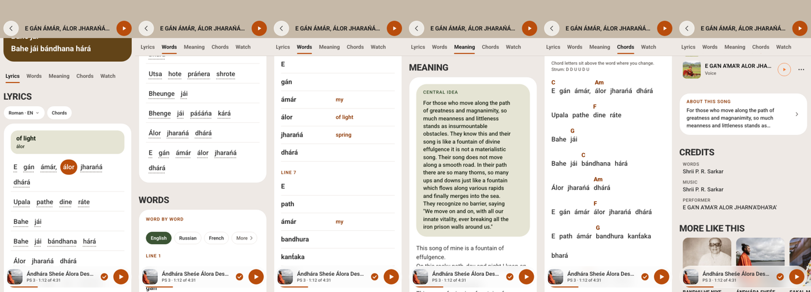

### 4.1 Variant A, "Pairs": one reading column

A 206 px photo banner, a play row, sticky tabs Read, Play, Watch, About. Read is a single column: each lyric line with its
translation under it, refrains collapsed. A segmented control switches Lyrics only or Lyrics + Meaning. A word tap opens a
bottom tray. A language sheet separates Official (English) from Machine-assisted languages. Page height about 2835 px.

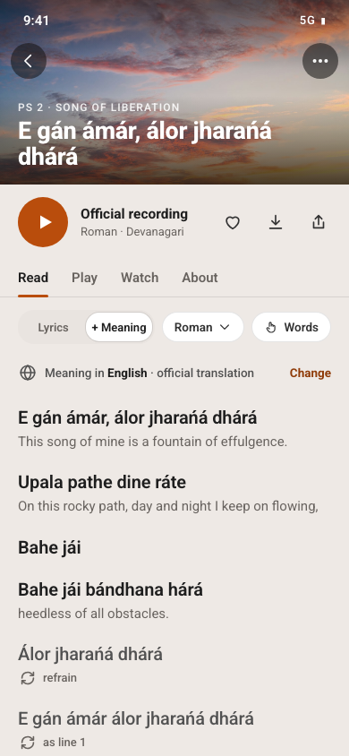
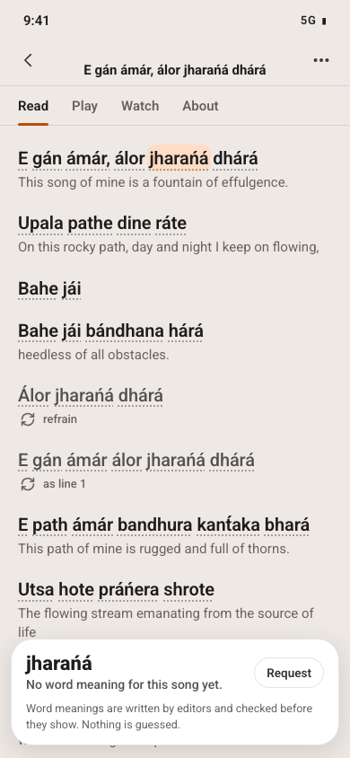
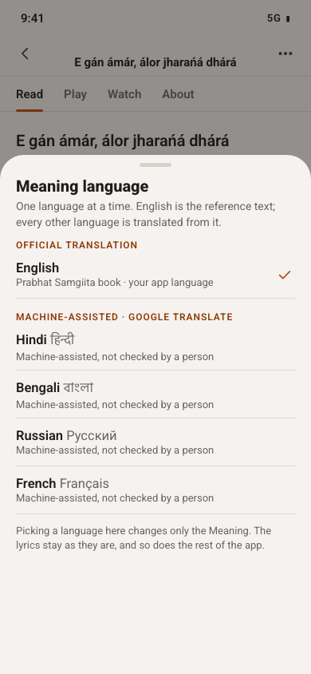
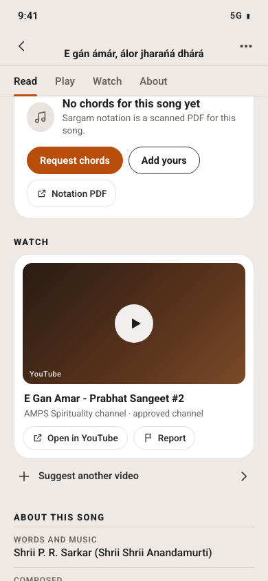
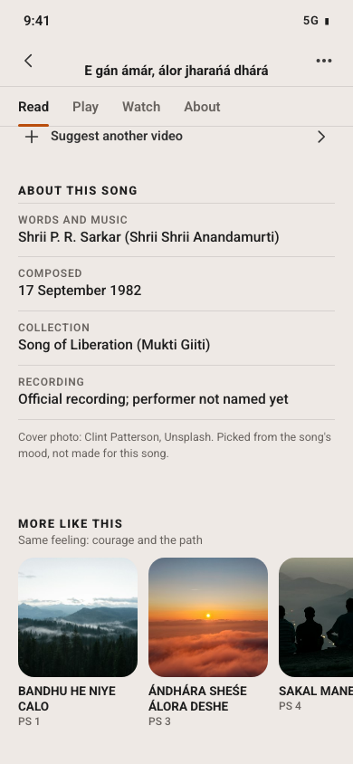

- Pros: it is exactly the "line by line, translation under each line" Dada asked for; first lyric line is at about y=455 of 844,
  so the song is visible without scrolling; one scroll, one block.
- Cons: needs aligned translations, which exist for about 3% of songs; shows a weaker mode (translation as one paragraph) for the
  rest; refrain collapsing needs an algorithm and editor override.
- Effort: M to L.
- Data needed: translation split into the lyric lines (a new field, editor- or AI-assisted, reviewed); refrain markers;
  central idea (40 songs).

### 4.2 Variant B, "Pages": pill tabs, each tab is a short page

A 214 px photo hero fading into the page, title below, a one-line About row, then pills Lyrics, Meaning, Play, Watch.
Each pill is its own short page. Lyrics is lyrics only. Meaning has its own language chip and the official tag, then the
translation as paragraphs. Play holds chords (layout shown with SAMPLE data, plus the honest empty state). Watch holds the video
card and the audio recordings. Heights: Lyrics about 1554, Meaning about 1121, Play about 1160, Watch about 1015 px.

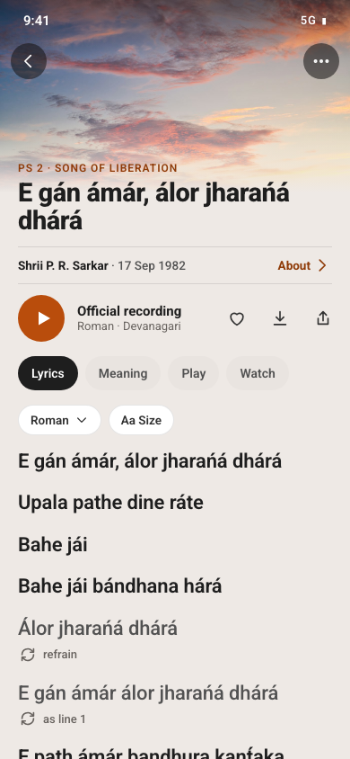
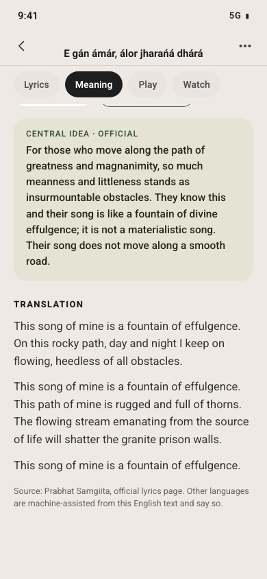
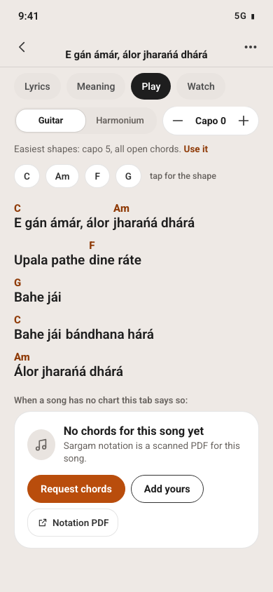
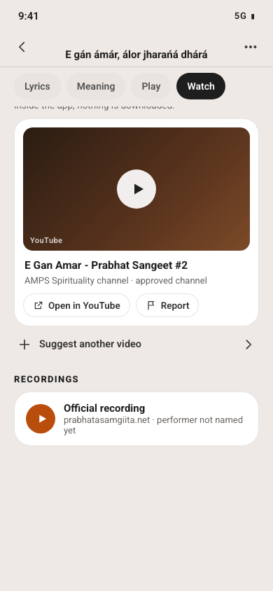

- Pros: works with today's real data, no alignment needed; closest to the present structure, so the least risk; cheapest.
- Cons: translation is not next to the line (Dada's "line by line" is only met later); the user flips between Lyrics and
  Meaning to follow along; four short pages feel like four screens.
- Effort: S to M.
- Data needed: none new for launch. Aligned lines upgrade it later.

### 4.3 Variant C, "Stanzas + sheets": stanza cards, everything else in sheets

A compact header with a 92 px photo thumbnail, title and play. Stanza cards (Stanza 1, Stanza 2), each with a foldable
Meaning line in English. Under them, rows: Play along, Words, Watch (opens a bottom sheet), About this song (opens a bottom
sheet). Page height about 1493 px.

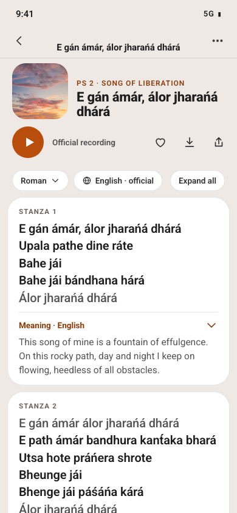
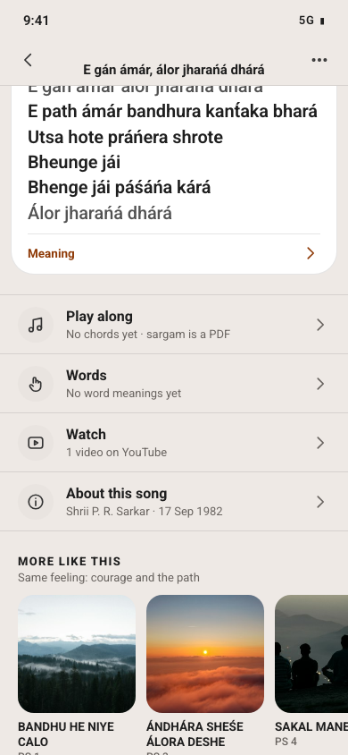
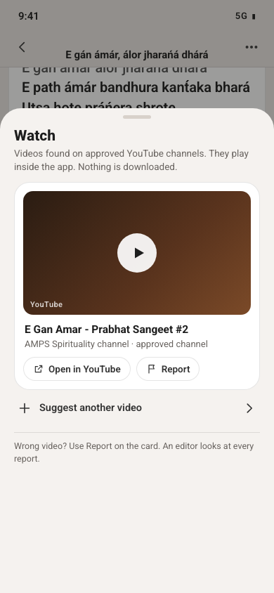
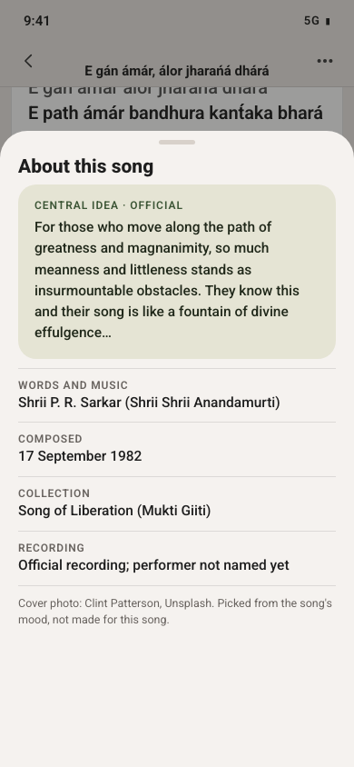

- Pros: shortest page; meaning is attached to a stanza, which is how people sing it; secondary things stay out of the way.
- Cons: needs stanza segmentation and stanza-level alignment (easier than line alignment, but still new data); the photo almost
  disappears (92 px), which loses the emotional entrance; many sheets hide features and make them harder to discover.
- Effort: M.
- Data needed: stanza boundaries (derivable from blank lines or refrain detection) and stanza-level translation split.

### 4.4 Height budget

| Page | Height at 390 px |
|---|---|
| Today (song 2) | 9303 px |
| Today (song 3, the best-covered one) | 6097 px |
| A, whole page | about 2835 px |
| B, longest tab (Lyrics) | about 1554 px |
| C, whole page | about 1493 px |

Budget rule for any variant: hero at most 25% of the first screen, lyrics start within the first screen, no tab longer than
about 3 screens (2500 px), tab strip pinned as a mini strip (one line, 44 px) after the hero scrolls away.

### 4.5 Comparison

| | A Pairs | B Pages | C Stanzas + sheets |
|---|---|---|---|
| Matches "line by line" | yes | not yet | stanza by stanza |
| Works with data today | partly | yes | partly |
| Shortest | no | tab-short | yes |
| Photo kept as a feature | yes | yes (largest) | no |
| Effort | M-L | S-M | M |

## 5. Recommendation

Build in two steps, using B as the foundation and A as the target.

1. Ship B's structure first (Phase 1). It is honest with today's data, it is the cheapest, and it deletes the lies: no fake
   Words, no fake Chords, no duplicate card, Meaning in one labelled language, Watch as a list, About and Credits merged. It
   already cuts the page from 9303 px to a longest tab of about 1550 px.
2. Move Lyrics + Meaning toward A (Phase 3) as aligned translations arrive. The Meaning tab and the Lyrics tab in B are
   the two halves that A joins; the same components can be reused. Songs without aligned data keep showing the B version,
   so there is never an empty or broken state.

Why not A alone: it promises a line-by-line view that only 3% of songs can honestly deliver today, so most songs would fall
back to a weaker mode anyway. Why not C: it hides the photo and adds sheets, and it needs the same new alignment data as A
for a smaller gain.

## 6. Data gaps: what must come from the API or editors

| Gap | Needed for | Where it comes from | Rough size |
|---|---|---|---|
| Line-aligned translation field (`translation_lines`) | A, later B | editors plus AI draft, reviewed; start with the most-sung songs | 5014 songs; start with 100 to 300 |
| Clean single English variant per song | all | editor pass on the 153 songs with several variants glued | 153 |
| Shared word glossary (Bengali/Sanskrit to English, then ru/es) | tap gloss, Learn | an editor-reviewed dictionary, ranked by frequency | 1000 words = 74% coverage, 2000 = 84% |
| Chord data | Play tab | contributors ("Add yours"), reviewed; no import from anywhere | 0 today |
| Sargam as text | Play tab | the existing `NotationCapture` admin workflow; PDF button for the rest | 3 done; 1098 PDFs |
| Video per song | Watch | existing YouTube scan/review workflow; 117 pending to approve | 782 of 5018 |
| Video title, duration, thumbnail | Watch list | thumbnail from `i.ytimg.com/vi/<id>/hqdefault.jpg` (no key); duration needs oEmbed or the YouTube Data API | 813 rows |
| Real performer | Versions, About | an explicit field per recording; stop deriving it from the audio title | per recording |
| Words / Music credit | About | keep "Shrii P. R. Sarkar" as a song-level fact, drop it from performer/credit rows | 5018 |
| Duration | header | read from the audio file; remove the 5:00 fixture | per recording |
| Mood / feeling tag | photos, More like this | review `song_categories_v0.json` (machine draft) | 3939 feeling, 839 time of day |
| Related songs | More like this | match on feeling/mood, not on `language` | 5018 |
| Translation provider labels | Meaning | `provider` field already exists (stored, cache, google, llm): show it | exists |

## 7. D. Photo rule

One rule decides the picture for the hero, the card thumbnails and the share image. Seed is `ps-N`, the same seed the share
sheet uses, so hero and share image always match.

Order of choice (first match wins):

1. Editor pick. If the song has a `photo_id`, use it.
2. Kiirtan with an uploaded cover. Uploaded covers belong to the uploader and the admin who approved them. Use the cover for
   that recording's card and for that recording's share image. The song-page hero stays on rule 4, so one upload does not
   replace the song's picture for everyone.
3. Performer photo. Only with the performer's consent and only as a small avatar next to the performer's name in Versions,
   never as the hero. Without consent, no photo.
4. Mood photo from the catalogue: `photoForSeed("ps-N", mood, {allowPeople: none or far, size: hero})`. No low-res images in
   a hero, warm photos first, cool only for night and long.
5. Fallback. If the pool is empty or the image fails to load: the first warm photo with no people; if even that fails, a
   tinted typographic card in sand/orange with the song number.

People rules (from `docs/photo-system.md`): heroes use only photos with no people or people far away; children, close-ups and
religious portraits are never cropped to the portrait alone; a photo with a person always carries a credit line in About.

Mood mapping (my proposal, unreviewed): time of day dawn gives morning, evening gives evening, night gives night; otherwise
feeling: peace or surrender gives calm, nearness or longing gives evening, joy gives festival, courage gives morning,
sorrow_hope gives night; otherwise no mood and the seed alone chooses. Resulting spread across the 5018 songs: evening 1611,
none 919, night 917, calm 669, morning 470, festival 432.

Catalogue today: 49 photos (27 Unsplash, 22 Ananda Marga). By people: none 27, far 8, close 8, children 6. Eligible for a hero
(none or far, not low-res): 34, of which 30 warm. Warm eligible per mood: morning 13, evening 10, night 3 (plus 3 cool),
festival 9, calm 20, long 12, live 8. Night is thin. `docs/photo-system.md` says a pool under 6 is a catalogue bug, so night
must be widened to night + long + calm, evening to evening + festival + calm, and more photos added. With 34 usable photos for
5018 songs, repetition is unavoidable until the catalogue grows. A hundred more no-people dawn, lake, forest and night photos
would remove most of it.

How the first seven songs look under this rule: 1 misty forest valley (27), 2 pink dawn (16), 3 sunrise over clouds (14),
4 hilltop far (05), 5 row of people (06), 6 silhouettes (07), 7 candle (10). Song 2 stops showing the boy with a guitar. Songs 5
and 6 get photos with people; check that they pass the "far" rule or swap them.

Code to change later (not now): replace `coverFor` in `SpHeroCover`, in the footer and in `SpMoreShelf`; keep the share sheet.

## 8. Phases

Phase 0, correctness (small, no design needed; do first):
- guard `fixtureExtras` so sample glosses/chords never reach real songs (`__DEV__` or `MOCKUP_DATA` only);
- stop reading Words language into Meaning (separate state);
- remove the 5:00 and the hard-coded Words and Music from performer/credit rows; stop deriving performer from the audio title;
- fix "More like this" to match on feeling/mood, never on `language`.

Phase 1, structure (variant B with today's data):
- one lyrics block, Play button in the header, brown card removed;
- tabs Lyrics, Meaning, Play, Watch; Words tab removed; word tap only when real glosses exist;
- Meaning: own language control, official versus machine label, default app language with English fallback;
- Play: honest empty state, Notation PDF button where a PDF exists, Request and Add yours;
- Watch: YouTube list with report/remove and Suggest a video;
- About and Credits merged; photo credit line;
- hero from the photo system (section 7).

Phase 2, data:
- seed the shared glossary (top 1000 words), wire tap gloss and Learn to it;
- clean the 153 multi-variant translations;
- review `song_categories_v0.json` and add photos for thin pools;
- approve the 117 pending videos; add thumbnails and durations.

Phase 3, line by line (variant A):
- produce aligned translation for the most sung songs first (editor plus AI draft, reviewed);
- merge Lyrics and Meaning into Pairs where `translation_lines` exists, keep B otherwise.

Phase 4, music:
- chord contribution flow and review; sargam capture for more songs; transposition from real data.

## 9. Top 6 decisions for Dada

1. Fix the fake data now (Phase 0), even before any redesign? Recommendation: yes. It removes every false thing at once.
2. Which variant? Recommendation: B first, A as the later target. Say if you want C or a different path.
3. Drop the Words tab and hover for good, keeping only tap-on-a-word when real data exists? Recommendation: yes.
4. Who owns the word glossary and the aligned translations: you, a small editor team, or AI drafts you review? This sets
   the pace of Phases 2 and 3. Recommendation: AI draft, human review, start with 1000 words and 100 songs.
5. Meaning languages: show only English as official, and label every other language "machine-assisted"? Or hold the
   other languages back until a human has checked them? Recommendation: show with the label, default to the app language.
6. Photos: approve the rule in section 7 (one seed for hero, cards and share; no portraits; uploaded cover only for its own
   recording; performer photo only with consent), and decide whether to commission about a hundred more no-people photos.

## 10. Caveats

- The mockups use one real song. The translation alignment in A and C was done by hand at the line breaks for the mockup only
  (wording unchanged); producing it at scale is a data task (section 6).
- The mood mapping and all categories come from a machine draft that nobody has reviewed.
- Word frequency counts are approximate (diacritics were stripped, a few non-word tokens inflate the count).
- Live API numbers come from a 120-song sample, file numbers are exact.

## 11. Files

- This document: `docs/song-page-redesign.md`.
- Mockup screenshots: `docs/assets/song-page/` (14 PNGs, 1.4 MB).
- Mockup sources (not committed): the scratchpad `mock/gen.py` that generates the HTML.

## 12. Decision: one page (combination of A, B and C)

Dada reviewed the three variants and chose a combination. It is now the only song page (`apps/mobile/components/song-page`,
route `app/song-v2/[songId].tsx`); the switcher, the old "Current" page and the variant code are gone (history stays in git).

- Header and action row as B (photo fading into the page, PS number, title, words-and-music line, Play / Download / Save /
  Add), plus a "Learn this song" button (adds to the Learn list through `addSongToLearn`) and a top Menu button that lists the
  sections the song has and scrolls to them.
- Pinned tab strip as A, acting as jump and scroll-spy links over one scrolling page: Lyrics, Meaning, Recordings, Chords,
  Video, Story, then About this song. A section appears only when the song has it; Lyrics, Meaning and Chords always keep a place
  and say honestly when they are empty.
- Lyrics keep the stored structure through `parseLyricStructure` (`lib/songPage/lyricStructure.ts`). The catalogue stores flat
  lines only (no blank lines, markers or indentation in any of the 5,017 songs with lyrics), so stanza breaks are derived where the
  song returns to its first line, a repeated line is one that matches an earlier line word for word, and "Refrain" is written only
  when a whole stanza is such a repeat (or when a stored text labels it, which no current song does).
- One translation-language chooser (a pill in the lyrics toolbar). The old "Change" button of the Meaning header opened the same
  language sheet, so it is removed.

### 12a. Update: one text block with three tabs, "Aa" popover (Dada's choice from the boards)

- "Meaning" is now **Commentary** everywhere the reader sees it (strip, menu, header line, empty states; ru "Комментарий",
  es "Comentario"). The section id and the tab id stay `meaning` in code.
- Section 1 is one block with three tabs in a pill switch: **Lyrics | Commentary | Word by word** (`components/song-page/TextBlock.tsx`).
  Commentary is a tab of this block, not a place of its own in the scroll: the strip and the menu still list it, and a jump
  to it scrolls to the block and opens the tab (`lib/songPage/blockTabs.ts`).
  - Lyrics tab = `LyricsBody.tsx`, kept in its own file so the final lyrics-with-translation layout can replace it.
  - Commentary tab = `Commentary.tsx` (board 3, variant A: one white card): the central idea and the explanation in plain
    words; a dashed note says so when no explanation is written. The translation text stays in the Lyrics tab.
  - Word by word tab = `WordByWord.tsx` (board 4, variant 1: interlinear). Real words with real counts; a tapped word lights
    the same word everywhere. With no verified glosses (every real song) it shows "No word meanings yet." and Request; no
    gloss is ever invented.
- The wide toolbar is gone. One round "Aa" button in the header row opens a compact popover (board 2, variant 1): text size,
  script, translation on or off and the translation language (`TextOptions.tsx`). Text size and the translation switch are kept
  on the device with the script and the language (`stores/songPageStore.ts`). The popover registers with `lib/sheetCover.ts`,
  closes on Back, Escape or a tap outside.
